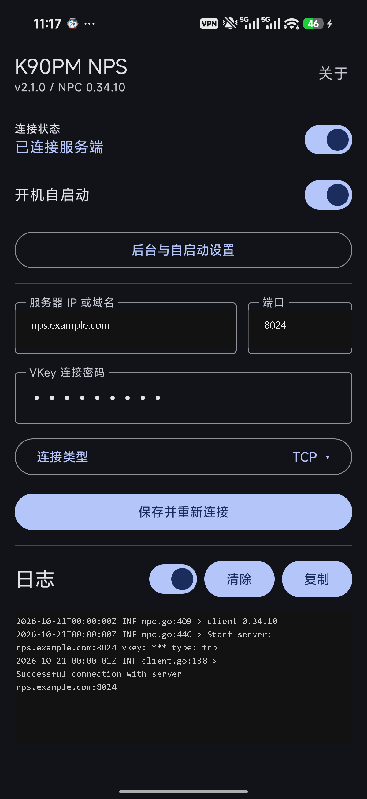
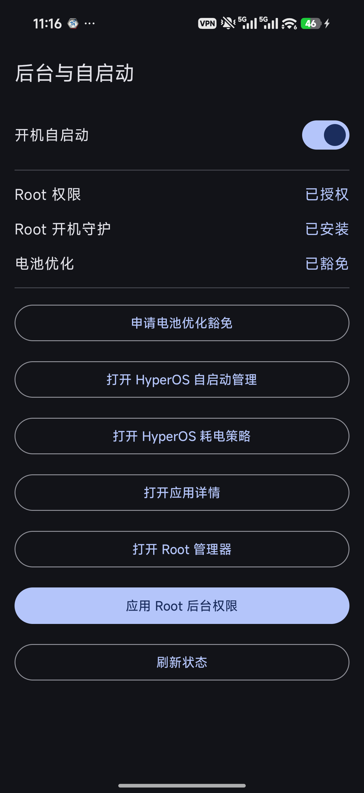

# K90PM NPS Client

面向 Android 的 NPS 客户端二开版本，基于
[djylb/npsclient](https://github.com/djylb/npsclient) 与
[NPS Enhanced](https://github.com/djylb/nps)，内置 NPC `0.34.10`。

项目只负责连接 NPS 服务端，不提供端口映射编辑。隧道、公开端口和访问策略全部由
NPS 服务端统一管理，适合禁止客户端修改连接配置和映射配置的私有部署环境。



## 功能

- 独立填写服务器 IP/域名、端口、VKey 和连接类型。
- `TCP`、`KCP`、`TLS`、`WSS`、`WS`、`QUIC` 下拉选择，默认 `TCP`。
- 点击“保存并连接”后立即保存并启动或重新连接客户端。
- 支持启动/停止、开机自启、后台运行和实时日志。
- Android `BOOT_COMPLETED` 与 Root `service.d` 双重自启动。
- Root 守护每分钟检查应用和 `libnpc.so` 进程，异常退出后自动重新拉起。
- 提供电池优化豁免、HyperOS 自启动管理、HyperOS 耗电策略和应用详情入口。
- 可通过 Root 将应用加入设备待机白名单、允许后台 AppOps 并设置 active standby bucket。
- 日志中的 VKey 自动替换为 `***`。



## 当前版本

| 项目 | 值 |
| --- | --- |
| 应用版本 | `2.1.0` |
| versionCode | `210` |
| 包名 | `com.k90pm.npsclient` |
| NPC 内核 | `0.34.10` |
| 最低系统 | Android 7.0 / API 24 |
| 编译 SDK | Android 16 / API 36 |

## 安装

从 Releases 下载 arm64 APK，或使用：

```powershell
adb install -r K90PM-NPS-2.1.0-arm64.apk
```

覆盖安装会保留已经填写的服务器、端口和 VKey。首次启动需要允许通知权限；Root
守护功能需要用户在 Root 管理器中授权。

## 使用

1. 填写 NPS 服务端 IP 或域名。
2. 填写 NPS 服务端客户端页面提供的端口和 VKey。
3. 选择与服务端配置一致的连接类型。
4. 点击“保存并连接”。
5. 在 NPS 服务端后台确认客户端上线，并添加需要公开的 TCP/UDP 隧道。

应用不会创建或修改隧道。NPS 服务端应关闭客户端配置上传能力，并配置端口白名单。

## Root 与保活

开启“开机自启动”后，应用会请求 Root 权限并安装：

```text
/data/adb/service.d/k90pm_nps_autostart.sh
/data/adb/k90pm_nps/autostart.enabled
```

守护脚本等待系统启动完成后发送显式广播，启动前台服务。运行期间每分钟检查
`com.k90pm.npsclient` 和 `libnpc.so`，进程缺失时自动重新拉起。关闭开机自启动会
删除守护标记和脚本。

HyperOS 的电池优化和后台限制不能只依赖普通 `BOOT_COMPLETED`。本项目同时提供：

- 标准电池优化豁免申请。
- HyperOS 应用级耗电策略入口。
- HyperOS 自启动管理入口。
- Root 设备待机白名单和后台 AppOps。
- Root 进程守护，作为厂商后台清理的兜底。

## 构建

需要 JDK 17、Android SDK 36，以及可访问 Gradle 依赖仓库的网络。

```powershell
$env:JAVA_HOME = "C:\path\to\jdk-17"
$env:ANDROID_HOME = "C:\path\to\android-sdk"
.\build.ps1
```

或直接使用 Gradle：

```powershell
.\gradlew.bat testDebugUnitTest assembleRelease
```

构建产物：

```text
app/build/outputs/apk/release/app-arm64-v8a-release.apk
app/build/outputs/apk/release/app-universal-release.apk
```

当前仓库默认使用本机 debug 签名生成可侧载 Release APK。正式分发前应配置自己的
签名密钥：

```text
KEY_ALIAS
KEY_PASSWORD
STORE_PASSWORD
STORE_FILE
```

## 实现说明

应用将 NPC 可执行文件作为 `libnpc.so` 打包，通过 `ProcessBuilder` 直接以参数数组
启动，不经过 shell。服务端地址、VKey、连接类型均由结构化配置生成：

```text
-server=<host>:<port>
-vkey=<vkey>
-type=<tcp|kcp|tls|wss|ws|quic>
```

Android 侧负责配置持久化、前台服务、进程生命周期、日志和保活；隧道协议与连接逻辑
继续使用 NPC `0.34.10`，因此与同核心版本的 NPS 服务端兼容。

## 安全建议

- 不要通过公网直接暴露 ADB、SSH、管理后台或未鉴权服务。
- 优先使用 TLS/WSS，并在 NPS 服务端限制来源 IP。
- 定期轮换 VKey，避免在聊天记录、截图或公开仓库中泄露。
- NPS 管理后台应使用强密码、HTTPS 和访问白名单。
- Root 守护脚本拥有系统级权限，安装前应确认其内容。

## 兼容性

- 主要验证设备：Xiaomi K90 Pro Max。
- 系统：HyperOS 3 / Android 16。
- Root：SukiSU Ultra，`su` 上下文为 `u:r:ksu:s0`。
- NPC 客户端版本：`0.34.10`。
- 服务端要求：与 NPC 核心 `0.34.0` 兼容的 NPS Enhanced 版本。

不同 HyperOS 版本可能调整系统设置页面组件。应用会尝试常用 MIUI/HyperOS Activity，
失败时回退到应用详情页。

## English Summary

K90PM NPS Client is a GPL-3.0 Android fork of `djylb/npsclient`. It provides a
structured connection form for an NPS server, multiple transport protocols, a
foreground service, Android boot startup, and an optional Root `service.d`
watchdog. It intentionally does not manage server-side tunnels or mapped ports.

## 开源与许可

- Android 客户端上游：[djylb/npsclient](https://github.com/djylb/npsclient)
- NPS Enhanced：[djylb/nps](https://github.com/djylb/nps)
- 原始 NPS：[ehang-io/nps](https://github.com/ehang-io/nps)

Copyright (c) 2026 K90PM for the Android customization.

本项目按 [GNU GPL v3](LICENSE) 分发。上游版权、许可证和归属声明继续有效，详细说明
见 [NOTICE](NOTICE)。
